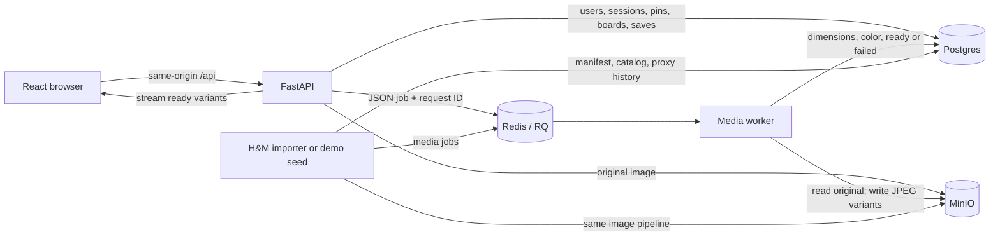

# Phase 1: the working product loop

This phase provides the product paths that later recommendation and logging modules use.
Discover is a paginated catalog, not a personalized recommendation surface. No ranking,
impression rules, experiment assignment, or simulator engine is implemented here.

## What each component does

| Component | Goal | Implementation |
|---|---|---|
| Identity | Let a person create an account and return later | Argon2id password hashes; opaque, expiring sessions stored as token hashes in Postgres; HttpOnly cookie; logout revocation |
| Pin API | Accept content and expose its processing state | Validates title/source link and actual image bytes; stores original in MinIO; creates pin record and RQ job |
| Media worker | Prepare usable images without blocking uploads on resizing | Decodes/orients image; strips metadata; flattens transparency; produces 400/1200px JPEG variants and dominant color; records ready/failed state |
| Boards/saves | Organize favorite pins | Board belongs to a user; unique `(board_id, pin_id)` makes save retries idempotent; removal is idempotent |
| Catalog/closeup | Browse and inspect available content | Cursor pagination; only ready pins enter catalog; detail and source link; images streamed through the API |
| React UI | Make the loop usable | CSS columns masonry, account forms, uploads/status/retry, boards, closeup/save/source, desktop/mobile layouts |
| Importer | Bootstrap reproducible content and historical proxies | Local H&M CSV/images, deterministic sampling/IDs, recorded manifest, async media jobs, separate imported purchases |
| Demo seed | Make the UI runnable before H&M is available | 32 locally generated illustrations labeled Demo; no transaction history |

## How they interact

1. Signup hashes the password, inserts the user, and issues a new random session cookie.
   Each authenticated request hashes that cookie token and looks up the unexpired session.
2. An upload validates the image, stores its original, inserts a queued pin, and enqueues
   a job. The API returns 202. Uploads polls processing state; catalog excludes unfinished pins.
3. The worker reads the original and writes two variants, then marks the pin ready. The
   browser loads derivatives through FastAPI; it never needs MinIO credentials or internal URLs.
4. Saving checks board ownership and pin readiness, then inserts a save. The database
   uniqueness constraint handles retries and concurrent duplicate saves. Other users cannot
   read or change your board through the current owner-only API; secret-board product features
   and public board sharing remain later work.
5. Importing writes source products and credential-free seeded identities, then uses the
   same worker for media. Purchases stay in a separate provenance-bearing table for Phase 2/3
   history and datasets. They do not create board saves or impressions.

## Routes

| Method | Path | Behavior |
|---|---|---|
| POST | `/api/auth/signup`, `/api/auth/login`, `/api/auth/logout` | Create/revoke cookie session |
| GET | `/api/auth/me` | Current account |
| GET | `/api/pins` | Public ready catalog, optional `limit` and `cursor` |
| GET | `/api/pins/mine` | Your uploads, including queued/failed states |
| POST | `/api/pins` | Multipart `image`, `title`, optional `description` and `source_url` |
| GET | `/api/pins/{id}` | Closeup; unfinished pins visible only to their owner |
| POST | `/api/pins/{id}/retry` | Owner retry after failed processing/enqueue |
| GET | `/api/media/{id}/{thumb|display}.jpg` | Ready JPEG derivative |
| GET/POST | `/api/boards` | List/create your boards |
| GET | `/api/boards/{id}/pins` | Cursor-paginated saved pins |
| POST/DELETE | `/api/boards/{board_id}/pins/{pin_id}` | Idempotent save/remove |

All API responses retain Phase 0 request IDs and diagnostics. Media jobs carry the upload
request ID or import run ID in operational logs. API documentation is at port 8000 `/docs`.

## Failure behavior and deliberate simplifications

- Images are capped at 12 MB / 24 million pixels; only static JPEG/PNG/WebP are accepted.
  EXIF orientation is respected; EXIF/GPS does not reach displayed derivatives.
- A failed enqueue leaves a visible failed upload and returns 503 with its pin ID. Its
  owner can retry after Redis recovers. Job failures retry three times with 2/5/10 second
  delays; the worker scheduler is enabled. An active job ID prevents stale attempts from
  replacing a newer attempt's database state.
- Postgres and Redis commits are separate. A process crash between them can leave a pin
  queued without a job. Automatic crash reconciliation/outbox delivery is a future operational
  exercise; failed-enqueue recovery and transient worker retries are tested now.
- Large raw uploads pass through the API and originals are retained. A larger deployment
  would use direct signed uploads, a CDN for derivatives, and explicit lifecycle policies.
- This is local basic authentication, with expiring sessions and browser Origin checks.
  Email verification, password reset, rate limiting, and account administration remain later work.
- The importer is intended to run one process per manifest. Input/policy changes produce a
  separate namespace; timestamps retain day-level ties and availability is a documented proxy.
- Simulator run isolation, application logical clocks, view/action events, and model/config
  attribution will be added at their planned milestones. No simulator capability is advertised yet.

## Learning checkpoint

1. Why does an upload return before its pin appears in the public catalog, and how does
   the UI learn that processing finished?
2. Why does saving the same pin twice produce one save, even when requests arrive together?
3. Why must an imported H&M purchase remain distinguishable from an app save/impression?

Revisit: resize on upload versus on demand; queued delivery versus an outbox/reconciliation
loop; serving images through the API versus signed URLs/CDN; single database versus sharding.
