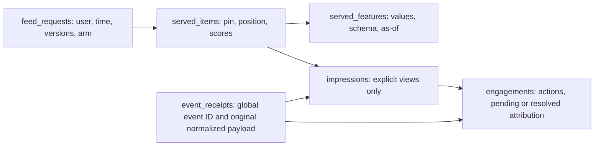

# Phase 2: baseline feed and logging

> This guide describes the preserved Phase 2 scaffold checkpoint. The shared serving,
> assignment, baseline ranking and event cores are implemented in the current Phase 4
> code. See PHASE4.md and PHASE4_WALKTHROUGH.md for current behavior and validation.

Status: **started; storage/API/interface scaffold implemented, learning core pending.**
The existing Phase 1 UI continues using `/api/pins`. It does not yet use the new feed,
emit impressions, or log actions. No Phase 2 completion tag is created until acceptance.

## What is ready and what it is for

| Component | Implementation | Purpose |
|---|---|---|
| Feed contracts | `app/feed/contracts.py` | Typed CandidateSource, Ranker, Reranker boundaries make implementations replaceable |
| Version registry | `app/feed/registry.py` | Resolve explicit versions; reject unknown versions and duplicate registration |
| Feed/experiment configuration | `app/experiments/config.py`, `Settings.feed_config` | Choose components and named experiment arms without changing serving code |
| Request and item schema | `app/logging/models.py`, migration `ddac47bcc846` | Persist the returned list, scores, versions, source names, and full feature snapshots |
| Event ledger and view/action schema | Same models/migration | Reserve event IDs across event types; constrain views to the exact served user, pin, and position |
| Event payload validation | `app/logging/schemas.py` | UUIDs, supported actions, complete attribution, an explicit view rule, and diagnostic client timestamps |
| API wiring | `app/feed/api.py`, `app/main.py` | Authenticated feed/events, normal origin checks, server UTC, and explicit 503 responses at pending exercises |
| Read-only inspection | `scripts/inspect_feed.py` | Compare served versus viewed items and inspect model/config/feature attribution |
| Learning tests | `test_phase2_exercises.py`, opt-in classes in storage integration tests | Concrete targets for ranking, assignment, time cutoffs, retries, conflicts, and reconciliation |

Table relationships:



Serving and ingestion logic still need to write these records. Schema constraints alone do
not implement retry conflict checks, atomic request persistence, or pending reconciliation.
The server can validate a view's attribution; it cannot independently prove viewport visibility.

## Implement the learning core in this order

The agreement's Learn mode applies to ranking, logging, and experiments. Each TODO has a
single named exercise and raises `LearningExercisePending` until implemented:

1. **`phase2-assignment` — `experiments/assignment.py`:** use the documented SHA-256
   serialization and bucket intervals. Golden vectors pin the algorithm across processes.
   The main alternative is persisted random assignment; deterministic bucketing makes
   repeat requests stable without an assignment lookup. Version/salt changes are deliberate
   assignment changes. Persist arms on requests; count exposure from views, not requests.
2. **`phase2-ranking` — `ml/baselines.py`:** implement pure recency and popularity orderings.
   Recency score is negative age in hours. Popularity score is distinct prior users with
   an observed save plus distinct prior users with an imported purchase proxy, with explicit
   equal weights. Keep the two counts separate in features. Zero history falls back to
   recency; ties use pin ID. This is an engagement proxy baseline, not estimated CTR.
3. **`phase2-candidates` — `ml/baselines.py`:** ready items must be both available and known
   by request time. Build features strictly from prior occurrence AND prior receipt time.
   Repeated purchases or board saves from one user do not multiply that user's count.
   Mutable board membership cannot recover historical saves, so use the immutable action
   stream. At v1 scale, retrieving the eligible catalog is simpler than a premature top-N
   shortlist. Later compare bounded SQL candidate retrieval and its coverage/latency.
4. **`phase2-feed` — `feed/service.py`:** resolve assignment/configuration, call the
   components, deduplicate pins, page, and commit request/items/features atomically before
   returning. Each page gets a new request ID and zero-based positions. Capture actual
   component versions and elapsed latency. Start with documented live offset pagination
   bound to user/config/arm; concurrent catalog/activity changes can move items between
   pages. A frozen ranked-session snapshot is the main later alternative. Treat a cursor
   as untrusted input; it cannot override server time or authenticated identity.
5. **`phase2-events` — `logging/service.py`:** validate against saved serving records,
   canonicalize the client payload, reserve a global event ID, persist one effect, and
   reconcile matching pending actions. An exact retry is a no-op; different content or
   another user reusing the ID is a 409. A new ID for the same served-item view reserves
   a ledger alias but creates no second impression. A reference to an alias must resolve
   to the original view. Concurrent races need constraint handling and rollback/re-read.
   Postgres is the v1 transaction boundary; a queue/log bus is the throughput alternative.

After the services pass their tests, wire the frontend to the feed response and retain each
pin's request ID and position across pagination and closeups. Implement IntersectionObserver
views: at least 50% visible continuously for one second, reset on reduced visibility or
hidden document, once per served item. Reuse event IDs and the original payload on retries.
The UI is the single telemetry producer for closeup/source and successful save actions;
board endpoints retain their existing product-state behavior. Telemetry must not perform
the board mutation or log the same action again. Observe delivery failures and reconcile
out-of-order arrival. Add browser and concurrent-ingestion tests before declaring completion.

## Time, labels, and simulator boundary

Normal requests use server UTC. An ordinary event's effective `event_time` is its first
server receipt; `client_event_time` is diagnostic and never controls time-dependent features.
`X-Sim-*` headers and body time/run overrides are rejected. Run registration, simulator
authentication, logical clocks, resets, and the separate simulator remain later work.

Imported history already exists from Phase 1. Real H&M data is still unavailable; the demo
has no imported purchases. Exercise fixtures contain explicit proxy history with time ties
and delayed receipt. Pending actions and unviewed served items are never implicit negatives.
Label materialization is Phase 3A: one-hour click/closeup and 24-hour save windows, only
closed negatives, declared cutoffs/lateness. Server receipt timing in ordinary UI mode is a
deliberate simplification; delayed simulator occurrence time requires the future adapter.

## Run and inspect

```bash
make check
make integration
make phase2-exercises
```

The last command opts into unfinished core targets and currently fails at their named TODOs.
Normal checks skip these targets; passing scaffolding tests does not complete Phase 2.
You can run one exercise with `RUN_PHASE2_EXERCISES=1 uv run --locked pytest -k assignment`.
Real-service exercise targets also require `RUN_INTEGRATION=1` and the running stack.

Once a feed request is actually persisted:

```bash
uv run --locked python -m scripts.inspect_feed --request-id <request-uuid>
```

The output includes versions, arms, served/viewed/unviewed counts, pending actions, and each
item's feature snapshot. A request not found returns exit code 2. No feed requests are
manufactured for the demo. Swagger at `/docs` exposes the new feed and event schemas now;
valid calls to pending services return 503, never a success acknowledgment.

Configure via JSON `FEED_CONFIG`; nested Pydantic defaults provide the two 50/50 baseline
arms. For a full recency rollout, define one arm with all 10,000 buckets and change the
config version. Unknown versions fail startup; allocation must be complete and arm names
unique. This is plumbing for experimentation, not evidence of an engagement improvement.

## Acceptance and explain-back

- Feed requests persist served items and full features with actual versions and arms.
- Serving alone creates zero views; each viewport view matches one saved served item.
- Retries, concurrent submissions, and second view IDs cannot inflate counts.
- Action-before-view delivery reconciles to the same authenticated user/request/item.
- Features exclude future availability, future actions, late receipt, and timestamp ties
  at the cutoff; imported proxy counts remain distinguishable.
- UI actions and actual views are verified in the browser. Pagination has new request IDs.

Explain-back remains **pending**, not graded or assumed:

1. Trace one returned but unseen pin, then one viewed/saved pin through the tables. Which
   can become a training negative, and when?
2. Why do an event ledger and a unique served-item impression solve different duplicate cases?
3. Why do old occurrence timestamps fail to make late-arriving information available earlier?

Revisit experiments: recency versus popularity under fixed candidates; SQL shortlist versus
full small-catalog retrieval; transactional ingestion versus a log bus; live pagination
versus frozen sessions; feature snapshots versus later explicit sampling.
