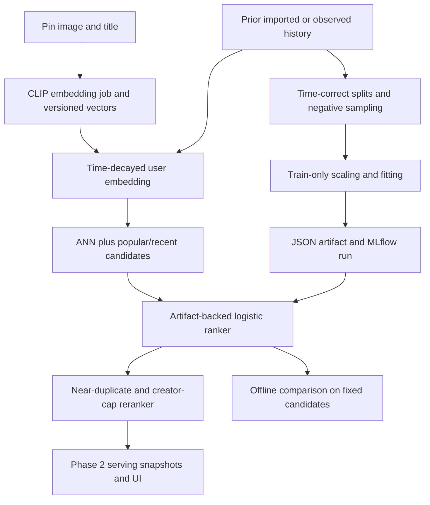

# Phase 3A: personalized ML v1

Status: **started; contracts, configuration, embedding storage, JSON artifacts, and learning
targets implemented. Core ML algorithms remain exercises.** Phase 2's core is still pending.
The current UI continues the Phase 1 catalog; there is no personalized feed or trained model.
Phase 3B (MIND CTR and production-operation exercises) is a separate later track.

## Goal and dependencies

The first finish line is a reproducible, personalized feed with cold-start fallback and a
measured comparison to recency/popularity. An honestly explained result that does not improve
the baseline is acceptable. The sampled implicit-feedback task is an engagement score;
its probability output is not measured CTR.

Pure normalization, user-vector, exact-retrieval, split, scoring, reranking, and metric
exercises can be developed on toy fixtures now. End-to-end serving additionally requires
Phase 2's baseline features, experiment assignment, atomic serving snapshots, and event
ingestion/UI telemetry. Actual training requires declared positive history, pinned content
embeddings, and ML runtime dependencies. The 32 demo pins have no purchase history.

## What is implemented

| Component | Files | Purpose and current limit |
|---|---|---|
| ML input contracts | `app/ml/contracts.py` | PinEmbedder/UserEmbedder protocols; typed content, vectors, histories, interactions and examples; finite numbers, aware times and explicit provenance |
| Personalization configuration | `app/ml/config.py` | Embedding identity/dimension/fusion, history decay, candidate quotas and diversity limits; configuration is not activated in the feed |
| Training manifest | Same file | Cutoffs, seed, sampling policy, source weights, availability policy, ties, fixed-model evaluation policy and import IDs |
| Vector schema | `app/ml/models.py`, migration `cdfce4ed4eea` | Embedding-model metadata and pin/content/model records; model/dimension consistency, unit vectors and unique identities |
| JSON ranker artifacts | `app/ml/artifacts.py` | Validated ordered features, coefficients, scaling, provenance and library versions; checksummed load and atomic no-overwrite publication |
| Core skeletons | `embeddings.py`, `retrieval.py`, `ranking.py`, `training.py`, `evaluation.py` | Named exercises with precise behavior; they explicitly raise pending instead of producing vectors, rankings, metrics or models |
| Read-only preflight | `scripts/phase3_preflight.py` | Static TODO inventory, installed package versions, optional DB counts and known missing prerequisites; not an acceptance certificate |
| Checks | `test_phase3_scaffold.py`, `test_phase3_storage_integration.py`, `test_phase3_exercises.py` | Artifact/provenance/schema checks and opt-in known-answer core targets |

`pgvector==0.4.2` and its NumPy dependency are locked and installed. Torch, OpenCLIP,
scikit-learn and MLflow are not installed; no pretrained weights are downloaded. The
inference/training runtime must be pinned before running those exercises, using a suitable
local or Linux container environment. No optional ML worker or model activation path exists yet.

## Intended interactions after completing the exercises



These arrows describe the planned data flow. The schemas/artifact tools work now; the core
functions and their feed/background-job wiring are pending. A training run must not
automatically activate its artifact. Before registry activation, validate model hash,
embedding/feature versions and dimensions; persist the actual versions in Phase 2 records.

## Learning exercises and alternatives

1. **Normalization:** implement unit-vector conversion and explicit rejection of empty,
   zero-norm and nonfinite inputs. The toy `(3,4)` vector has expected result `(0.6,0.8)`.
2. **Pin embeddings:** use pretrained OpenCLIP ViT-B-32 and the selected LAION checkpoint,
   evaluation preprocessing/inference mode, normalize image/title outputs, take the weighted
   mean and normalize again. Default dimension is 512 and image weight is 0.5. Record the
   exact weight hash and library/preprocessing/text policy. Alternative: image-only embeddings,
   then a learned fusion or fine-tuned encoder. Validate real batches before claiming CLIP works.
3. **User embeddings:** select the last N eligible prior interactions, apply exponential
   decay using a recorded half-life, average and normalize. Default N=50, half-life=168h.
   N is a soft cap: retain the complete boundary timestamp group. Strictly exclude current-time
   ties, future occurrence, late availability and other users.
   Empty/canceling history returns None and uses cold-start fallback. Alternative: multiple
   interest vectors or a learned user encoder.
4. **Exact retrieval:** cosine similarity on a small eligible same-model subset, deterministic
   ties and top-k. This is the reference against which ANN recall is measured.
5. **ANN retrieval:** create a per-model/version/dimension HNSW expression/partial index and
   a matching query, with availability filtering and latest-known content revisions. There
   is no ANN index yet. Compare recall and latency to exact retrieval on the same queries;
   two-dimensional schema fixtures do not establish retrieval performance.
6. **Candidate blend:** default pool=100 with 70% ANN, 15% popularity and 15% recency; allocate
   deterministic quotas, deduplicate, preserve source names and backfill shortfalls. No-history
   users use the configured baseline. Alternative: learned blending or graph candidates.
7. **Splits:** use half-open chronological train/validation/test ranges, keep source timestamp
   ties together, and exclude outside-range rows. Splits precede fitting any transform.
8. **Examples:** target positives are imported purchases and observed/simulated saves;
   closeups/source clicks may inform history but are not the v1 positive target. Add seeded
   eligible sampled-unobserved negatives. Build
   features only from prior available history; do not consult future outcomes to remove a
   negative. Record the universe, seed, ratios, shortfalls and source weights. False negatives
   remain a limitation of this proxy task. Unseen served pins are not observed negatives.
9. **Training:** fit scaling and weighted logistic regression using the training period;
   use validation for selection, keep final test separate, reject empty/single-class input,
   export the JSON artifact and track the manifest/run in MLflow. Alternative: LightGBM.
10. **Ranking:** use artifact feature order and train-only means/scales, then stable logistic
    scoring and ordering. V1 features: similarity, age_hours, observed_save_count,
    imported_purchase_count, user_history_count. Position is excluded. Keep original values
    in served snapshots so online inputs can be compared to offline inputs.
11. **Reranking:** preserve ranked order while suppressing near-duplicate vectors and capping
    known creators. Unknown owner IDs do not all share one creator bucket. Alternative:
    MMR diversity; compare the same list with and without reranking.
12. **Evaluation:** recall@k, binary NDCG@k and eligible-catalog coverage; empty target/catalog
    cases are undefined (None), not zero-valued observations to average. Record candidate
    policy, cohorts, eligibility, model/feature versions and query count. Compare identical
    candidate sets and target definitions. Later observed-impression CTR uses its own labels.

## Availability and leakage policy

Imported source interactions may be years older than the date we load them. Two policies
must remain distinguishable:

- **recorded_receipt:** live/delayed-event history is available only after its actual receipt
  and occurrence. A backdated client/simulator event is not known earlier just because its
  occurrence time is old. Live pins and computed vectors also have known times.
- **historical_import_replay:** offline source-only replay may map the imported dataset's
  chronology to replay availability, preserving original receipt metadata separately. The
  manifest permits this policy only for declared imported purchase proxies and exact import
  runs. The source adapter and point-in-time feature builder remain core work. Pretrained
  content vectors may represent content available at the example time, under an explicit
  fixed-content evaluation policy; this does not imply the live embedding job ran then.

Always specify which policy produced an example. Keep the model fixed during evaluation;
earlier evaluation interactions may update history under the recorded policy. Coarse ties
must not be ordered to allow one tied outcome to influence another. Imported namespace
merging and shifted dates require the Phase 1 manifest policy; do not silently mix imports.

## Run and inspect

```bash
make check
make integration
make phase3-preflight
make phase3-exercises
```

The core targets are skipped by ordinary checks and intentionally fail at TODOs when opted
in. Start with `RUN_PHASE3_EXERCISES=1 uv run --locked pytest -k normalization`. The current
16 known-answer cases cover normalization, history cutoffs, exact retrieval, split ties,
future-positive negative sampling, empty training, scoring, reranking and metrics. Real
CLIP batches, ANN recall/latency, full model fitting, serving swaps and final evaluation need
additional acceptance checks when those implementations exist.

To inspect actual configured database counts without writing anything:

```bash
uv run --locked python -m scripts.phase3_preflight --database
uv run --locked python -m scripts.phase3_preflight --database --fail-on-pending
```

The last command returns exit 2 for known missing prerequisites. Static inventory is not
runtime verification: removing a pending raise does not prove correctness. Artifact and
evaluation acceptance are explicitly listed as unchecked. No training, downloads, simulator
traffic, model activation or fake scores are performed by preflight.

## Completion and explain-back

Before declaring Phase 3A complete, finish Phase 2 acceptance, provide actual declared
history, pin the ML runtime/checkpoints, generate vectors, prove cold-start and personalized
serving, record reproducible offline baseline comparisons, and demonstrate a configuration
swap/rollback with attributable requests. Current scaffold checks do not satisfy these gates.

Explain-back outcomes remain pending:

1. Why can a late event's old timestamp leak information into historical features? How does
   the imported replay policy differ from a live delayed-event policy?
2. What do exact retrieval, ANN recall and cold-start fallback each verify?
3. Why isn't the implicit ranker's sigmoid output CTR, and which transforms must be fitted
   only on training data?

Revisit: single versus multiple user embeddings, full catalog versus ANN shortlists,
logistic regression versus LightGBM, duplicate/creator caps versus MMR, and measured model
rollout/rollback under later simulator workloads. The simulator remains a separate project.

## Primary implementation references

- [OpenCLIP usage and pinned pretrained model selection](https://github.com/mlfoundations/open_clip#usage).
- [ViT-B-32 model definition](https://github.com/mlfoundations/open_clip/blob/main/src/open_clip/model_configs/ViT-B-32.json).
- [pgvector Python SQLAlchemy integration](https://github.com/pgvector/pgvector-python#sqlalchemy).
- [pgvector mixed dimensions and per-model expression/partial indexes](https://github.com/pgvector/pgvector#can-i-store-vectors-with-different-dimensions-in-the-same-column).
- [scikit-learn logistic regression](https://scikit-learn.org/stable/modules/generated/sklearn.linear_model.LogisticRegression.html).
