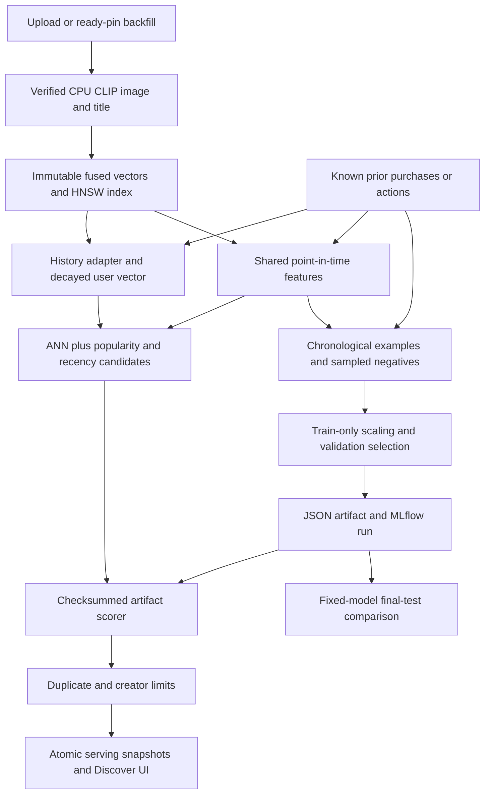

# Phase 3A: personalized recommendations and evaluation

Status: **implementation complete; validated with real CLIP inference and an explicitly
synthetic interaction trace.** The original Phase 3A algorithm exercises now run in the
ordinary test suite. Real H&M data and real-user recommendation quality remain unmeasured.
Explain-back discussion is open. Phase 3B CTR and the simulator adapter remain separate.

## What each component does

| Component | Implementation | Goal |
|---|---|---|
| Pin encoder | `ml/embeddings.py`, `infra/lens/server.py` | Encode canonical image pixels and the title, normalize each, average 50/50 and normalize again |
| Immutable vectors | `ml/vector_store.py`, `ml/models.py`, migration `72aa31f096bc` | Keep content/model versions and known times; index the fused 512-dimensional space separately from Lens |
| Media/backfill path | `app/media.py`, `scripts/backfill_personalization.py` | Generate both image-only Lens and image/title recommendation vectors on uploads; fill existing ready pins idempotently |
| History adapter | `ml/data.py` | Load declared imported purchases and resolved observed actions; keep occurrence, actual receipt and availability separate |
| User encoder | `ml/embeddings.py` | Normalize a time-decayed mean of prior known interactions; empty/canceling histories use a baseline |
| Shared features | `ml/features.py` | Use one implementation offline and online for similarity, age, separate save/purchase counts and history length |
| Candidate blend | `ml/retrieval.py` | Retrieve HNSW, popularity and recency quotas, merge contributors, deduplicate and fill shortfalls |
| Training examples | `ml/training.py` | Chronological splits, explicit purchase/save positives and reproducible sampled-unobserved negatives |
| Fitting and tracking | `ml/training.py`, `scripts/train_personalization.py` | Train-only scaling, weighted logistic regression, validation-only C selection, JSON publication and MLflow |
| Scoring | `ml/ranking.py` | Load pinned scaling and coefficients, score without fitting, preserve inputs and sort ties by pin ID |
| Diversity | Same file | Preserve rank order while removing duplicate IDs/near-identical vectors and limiting known creators |
| Evaluation | `ml/evaluation.py`, `ml/offline.py` | Compare fixed eligible candidate sets, Recall@k, NDCG@k and coverage; separate cold/warm cohorts |
| Activation | `experiments/config.py`, `feed/service.py` | Validate an explicitly selected artifact and recipe; record actual ranker, versions, hash, features and fallback reason |

All paths are relative to `backend/app` unless a scripts/infra prefix is shown. Existing
candidate-source, ranker, reranker and embedder interfaces remain replaceable.
[PHASE3A_WALKTHROUGH.md](PHASE3A_WALKTHROUGH.md) follows the core statements and alternatives.

## How the parts interact



The API does no CLIP inference or training on a feed request. Upload workers and explicit
backfill generate vectors. Serving uses the stored vectors, available history and a JSON
artifact. Fitting writes a new run directory; it never changes the active feed. A new user
gets the configured baseline; prior saves, closeups and source clicks can build a user
vector. Only saves/purchase proxies are positive training targets.

## Recipe, time and label contracts

The recommendation space is `embedder:clip-image-title:v1`; Lens keeps its independent
`embedder:clip-image-crop:v1`. Both use the verified OpenAI ViT-B/32 checkpoint with SHA256
`40d365715913c9da98579312b702a82c18be219cc2a73407c4526f58eba950af`. This replaces the
scaffold's proposed LAION checkpoint with the already pinned local runtime. Titles use
CLIP's tokenizer, at most 75 content tokens plus start/end tokens; preprocessing is
`openai-clip:eval224:v1`. The runtime uses Torch 2.6 CPU in evaluation/inference mode.
A changed fusion, tokenizer, checkpoint or preprocessing requires a new recipe version.

History occurrence **and known time must be strictly before the feature cutoff**. N=50 is
an initial soft limit: all events tied at the boundary remain. The half-life is 168 hours;
relative decay avoids underflow without changing the normalized direction. Opposing vectors
can cancel and deliberately return no user vector. Serving validates the history policy
against the trained artifact.

Pending actions are excluded. A resolved action becomes available after its own receipt,
its canonical impression receipt and any explicitly referenced alias receipt. Raw action
receipt stays intact. Replaying an old cutoff therefore cannot use a later reconciliation.
Baseline save counts use the same resolution cutoff.

`recorded_receipt` keeps live receipt availability. `historical_import_replay` requires exact
import IDs, only purchase proxies, and preserves raw receipt while mapping source chronology
to offline known times. `label_known_through` records dataset extraction time; set it to the
actual extraction time for imports received after their historical test period.
`fixed_import_content` explicitly allows the imported catalog's content representations
at source availability times; it never changes live vector/pin timestamps. No import user
namespaces are merged. Future/tied outcomes cannot affect another event's features or its
negative universe. V1 samples alternatives to this target, including earlier-positive pins;
they are unobserved for this target event, and can be false negatives. Excluding only prior
known positives is a separate sampler experiment. A sampled negative may later be purchased.
Unseen served items are not observed negative impressions. Sigmoid scores are
**engagement scores, not measured CTR**.

## Run, inspect and activate

From the repository root, with the normal local stack ready:

```bash
uv sync --locked --group ml
make personalization-backfill
uv run --locked --group ml python -m scripts.train_personalization \
  --synthetic-validation --output data/ml/my-validation-run
```

Choose a new output directory for every run. Outputs are `ranker.json`, `feed-config.json`,
`training-manifest.json`, `sampling-audit.json` and `evaluation.json`. The sampling audit
records each target's seed, eligible-universe hash/count and shortfall. Model artifacts
include ordered features, scaling, coefficients, C-selection results and the MLflow run ID.
MLflow stores full manifests, the artifact, final metrics and audit in `mlruns/phase3a.db`.
Training code and the full dependency lock are versioned; local weights, runs and artifacts
are ignored data. Scikit-learn 1.7.2 and MLflow Skinny 3.5.1 are pinned, with SQLAlchemy 2.0
for compatibility. Torch belongs to the isolated CLIP service, not the API/host environment.

Activate the newly generated config explicitly:

```bash
FEED_CONFIG="$(cat data/ml/my-validation-run/feed-config.json)" \
  docker compose up -d --no-deps --wait api
docker compose restart web
```

The artifact path must be relative under `data/ml` for Docker's read-only `/app/data/ml`
mount. The generated command above has that form when the output is a relative path.
An artifact checksum, embedding/feature version, dimension or history-policy mismatch
rejects activation. Missing/malformed artifacts do not silently become a different model.
Default Discover for signed-in users uses this feed, so opening/saving pins and refreshing
lets you inspect personalized results. An unregistered vector recipe also rejects serving.
To restore the committed baseline config (or reproduce the baseline browser suite):

```bash
FEED_CONFIG='{}' docker compose up -d --no-deps --wait api
docker compose restart web
```

Each restart uses an explicit configuration. A later plain `make up` uses the default
baseline unless `FEED_CONFIG` is supplied again. The old requests retain their actual model
and feature snapshots after rollback. Training never performs these activation commands.

For an actual imported dataset, supply a `TrainingManifest` JSON with its exact import IDs,
source chronology/cutoffs, explicit availability/content policy and extraction time:

```bash
uv run --locked --group ml python -m scripts.train_personalization \
  --manifest data/manifests/hm-training.json --output data/ml/hm-run-001
```

The normal importer and vector backfill must have completed first. Historical replay needs
`availability_policy: historical_import_replay`, `content_policy: fixed_import_content`,
`source_weights: {imported_purchase_proxy: 1}`, and `label_known_through` at extraction time.
For resolved app/simulator saves instead, the same command accepts `recorded_receipt`,
`recorded_content`, no import IDs, and the explicitly declared observed/simulator source
weights. It uses the visible vector-backed catalog without rewriting known times.
An empty/single-class training split or an empty eligible test task raises instead of
producing a claimed successful model. Validation selects C from 0.1/1/10; with no validation
rows the smallest declared C is explicitly used, and final test never participates in fit.

Checks:

```bash
make check
make integration
uv run --locked --group ml python -m scripts.evaluate_personalized_retrieval
uv run --locked --group ml python -m scripts.phase3_preflight --database --encoder
RUN_PERSONALIZED_UI=1 npm --prefix frontend run test:e2e -- phase3-personalized.spec.ts
```

Preflight is an inventory, not acceptance. Optional `--artifact PATH --sha256 HASH
--evaluation PATH` checks that a report matches a loaded artifact. Runtime tests and
real-data quality are separate evidence.

The targeted browser command requires the explicit personalized config. Run the ordinary
full browser suite with the baseline config, then clean its recorded accounts using
`uv run --locked --group ml python -m scripts.cleanup_browser_tests` before another suite.

## Measured result and limits

Generated reports and fitted artifacts remain local and are excluded from GitHub history.
The commands above reproduce checks and generate fresh evidence; historical measurements
below describe the validated local run.

Local `phase3a-checks.json` records 163 passing unit checks, 60 unique
integration checks (59 in the full regression plus the added import acceptance), 10 baseline
browser checks and 2 personalized desktop/mobile checks. Ruff, TypeScript/Vite, schema drift,
repeat-backfill idempotence and exact cleanup also passed. The 15 skipped backend cases are
the independent Phase 3B CTR exercises.

Local `phase3a-evaluation.json` records 97 authored fixture saves,
485 examples and 25 final-test queries on the 32 real fused demo vectors. The 12-day trace
uses a fixture chronology after vector availability and is never inserted into app history.
It validates the mechanics without building a simulator preference model.

| Method | Recall@10 | NDCG@10 | Coverage |
|---|---:|---:|---:|
| Recency | 0.24 | 0.150 | 0.3125 |
| Popularity | 0.64 | 0.297 | 0.34375 |
| Logistic ranker | 0.60 | 0.319 | 0.3125 |
| Similarity | 0.96 | 0.377 | 1.0 |
| Logistic plus diversity | 0.44 | 0.269 | 0.25 |
| Serving policy, including cold fallback | 0.44 | 0.269 | 0.40625 |

The ranker improves ordering by NDCG but misses more top-10 targets than popularity.
Diversity removes similar pins and loses recall on this authored repetitive trace. All
rankers see the same eligible catalog; the model is fixed while earlier test actions can
update history. This establishes neither a real-user benefit nor measured CTR.
Local `phase3a-retrieval.json` records 16 pin/mean queries, top-10
exact/HNSW agreement 1.0 and median exact/ANN time about 4.83/17.46 ms. The actual query plan
uses `ix_personalized_clip_hnsw` with scans/sorts forced off; this tiny corpus shows no ANN
speed advantage. Full-catalog ranking evaluation does not measure large-catalog shortlist
loss. The fitted input/model version repeated across independent runs.

V1 deliberately loads eligible catalog/history into memory. Features and baseline lists
are clear study implementations, not a production-scale feature store. Larger datasets need
indexed history windows, batched/cached feature aggregation, measured shortlist recall and
bounded training batches. Real H&M/user-history quality acceptance remains open.

Revisit: image-only versus fused content, multiple user interests, candidate quotas,
logistic versus LightGBM, duplicate/creator limits versus MMR, and measured rollout under
the separate simulator's later operations exercises. Explain-back questions and the
statement walkthrough are in PHASE3A_WALKTHROUGH.md; discussion is not assumed complete.

The original checked local app uses `data/ml/phase3a-validation-v3/feed-config.json` and model
`ranker:logreg:651ebd20368e5b6f`. This is an explicitly synthetic-validation model. The
baseline configuration remains the source default; use the documented rollback command.
The GitHub checkout starts with that baseline and requires a new local training run before
activating personalization; the original validation files are not included.

Primary references: [CLIP implementation](https://github.com/openai/CLIP),
[StandardScaler](https://scikit-learn.org/stable/modules/generated/sklearn.preprocessing.StandardScaler.html),
[LogisticRegression](https://scikit-learn.org/stable/modules/generated/sklearn.linear_model.LogisticRegression.html),
[MLflow tracking](https://mlflow.org/docs/latest/ml/tracking/tracking-api).
