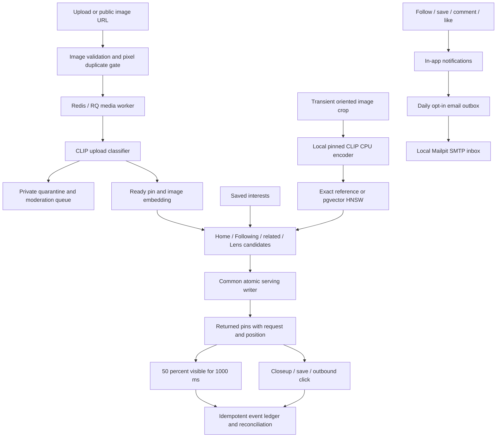

# Phase 4: product extensions and visual discovery

Phase 4 is implemented. This checkpoint finishes Following and related discovery, CLIP
crop search, onboarding, image URL import, engagement, local email digests and moderation,
in addition to the search/social/board modules from the earlier Phase 4 checkpoint.
The shared Phase 2 serving, assignment, baseline ranking and event ingestion code was also
completed because these surfaces require it. Separate Phase 3A model training and Phase 3B
CTR exercises are still separate tracks; this checkpoint does not claim they are finished.

## Modules and goals

| Module | Main code | Purpose |
| --- | --- | --- |
| Home serving and attribution | `app/feed/{service,persistence}.py`, `app/logging/service.py` | Rank eligible pins, record immutable served features, accept retry-safe views and actions |
| Text search | `app/search/` | PostgreSQL full-text search, typeahead and filter-bound pagination; authenticated result lists use the common attribution writer |
| Following | `app/ml/discovery.py` | Merge followed creators and followed public boards; keep all contributing sources and exclude secret boards, future records, blocks, mutes and hidden pins |
| Related pins | `app/ml/discovery.py` | Rank by distinct shared public boards; use same-recipe image similarity when eligible co-board evidence is absent |
| Lens | `app/discovery/`, `app/ml/{discovery,retrieval,vector_store}.py`, `infra/lens/` | Prepare an oriented crop, encode it with pinned CLIP, search compatible vectors and record attributed results |
| Onboarding/settings | `app/product/{models,api}.py`, `frontend/src/Extensions.tsx` | Persist optional interests, completion state and email opt-in; add an explicit keyword-match ranking boost |
| Profiles and boards | `app/social/`, `app/boards/` | Public profile board/created-pin tabs, names/bios, user/board follows, blocks/mutes, secret boards and sections |
| URL import | `app/product/url_import.py` | Fetch a bounded public direct-image URL, then use the same upload/worker pipeline |
| Thin engagement | `app/product/api.py`, `frontend/src/PinActions.tsx` | Comments, one like per user/pin, shareable links, hide/unhide and reports |
| Activity and email | `app/social/`, `app/product/digests.py` | In-app follows/saves/comments/likes; opt-in daily outbox delivery to a local SMTP sink |
| Safety | `app/product/safety.py`, `app/media.py`, moderation endpoints | Exact oriented-pixel duplicates, a versioned zero-shot upload hold policy, private quarantine and operator review |



## Running and trying the result

```bash
make up                  # explicitly prepares verified local weights before starting
make lens-backfill       # index an existing ready catalog; new uploads index automatically
make lens-evaluate       # write a real exact/HNSW crop comparison
make check
make integration
make browser-check
make phase4-preflight
```

The app is at `http://localhost:8080`; API readiness is at
`http://localhost:8000/health/ready`. Mailpit is at `http://localhost:8025` with local SMTP
on port 1025. The CLIP service is bound to localhost port 8090. Weights live under ignored
`data/models/`; they are not in Git. `scripts.prepare_lens` verifies the published SHA-256
and neither request handlers nor the encoder download weights implicitly.

Sign up, choose interests from the onboarding banner or Settings, follow a creator or a
public board, and open Following. Open a ready pin to comment, like, share, save, hide or
report it. Lens accepts an image and normalized left/top/right/bottom coordinates with a
live crop outline. Uploaded pins appear in Uploads while processing, awaiting review or
removed. Settings can restore hidden pins and opt into daily activity email. Activity shows
notifications and email delivery state.

Moderator rights are a local operator action, never a registration field:

```bash
uv run --locked python -m scripts.moderator your-local-account@example.test
# Reload the app, open Moderation, inspect an image, then remove / restore / dismiss.
uv run --locked python -m scripts.moderator your-local-account@example.test --revoke
```

Ordinary accounts cannot read the moderation queue or its private image route. Reviews
are recorded with reviewer, time and action. Repeating the same decision is idempotent;
a different decision on an already reviewed report returns 409. A new review can reconsider
a removal. Restoring requires completed media variants. Dismissing a report closes the
report; it does not publish a quarantined image.

## API additions

| Route | Behavior |
| --- | --- |
| `GET /api/feed` | Authenticated home FeedPage with stable arm assignment and persisted feature snapshots |
| `POST /api/events` | Authenticated impression/engagement ingestion; same ID/payload is duplicate, conflicting reuse is 409 |
| `GET /api/feed/following` | Authenticated, cursor-bound Following FeedPage |
| `GET /api/pins/{id}/related` | Eligible public co-board neighbors or image-similarity fallback |
| `POST /api/lens` | Multipart image, crop_box JSON, limit and optional cursor; attributed visual matches |
| `GET/PUT /api/settings` | Interest onboarding and email digest preference |
| `GET /api/settings/hidden` | The first 100 hidden pins for the current account |
| `POST /api/pins/import` | Title, description, public direct-image URL; async upload pipeline |
| `GET/POST /api/pins/{id}/comments`, `DELETE /api/comments/{id}` | Paginated comments; delete own comments or moderator removal |
| `GET/PUT/DELETE /api/pins/{id}/reaction` | Visible counts and idempotent per-user like |
| `PUT/DELETE /api/pins/{id}/hide` | Hide from discovery or show again; board membership remains |
| `POST /api/pins/{id}/report` | One user report per pin, preserved on retries |
| `GET /api/moderation/reports`, `PUT /api/moderation/reports/{id}` | Moderator-only queue and decisions |
| `GET /api/moderation/pins/{id}/image` | Moderator-only processed image, including quarantined/removed pins |
| `POST /api/notifications/digest`, `GET /api/notifications/digests` | Request own digest and inspect own delivery state |

Search retains its PinPage-compatible shape and adds `attributed`; authenticated search
records the list without creating a view. Anonymous catalog/search browsing and typeahead
do not create recommendation events. A direct authenticated closeup can be unattributed.
The UI attaches the originating request/position to recommendation and related-pin actions.

## Core behavior and boundaries

Serving follows assign → retrieve → deduplicate → rank → rerank → page → persist. Each
page has a new request ID and positions restart at zero. Request, item and feature records
commit together. Returning a result never inserts an impression. The browser creates one
view after continuous 50% visibility for 1000 ms, cancels the timer when hidden and retries
with the same event ID. Global receipt IDs and request row locks handle concurrent retries,
second view IDs and engagements that arrive before views. Ordinary event time is server
receipt time; client time is diagnostic. Telemetry never mutates boards.

Features count prior known save telemetry and imported purchases separately, deduplicated
by user/pin with occurrence and receipt strictly before the feature cutoff. Mutable board
membership is used for current social discovery, not historical ML save counts. Source
records, ready state, availability, known time, blocks/mutes and hidden pins gate candidates.
Secret-board membership never supplies related/Following evidence. Pins themselves remain
public when ready; secret boards protect their membership, not the uploaded pin.

Interest onboarding is optional. The first baseline matches declared interest words in
pin titles/descriptions, snapshots `interest_matches`, and adds
`matches * FEED_CONFIG.interest_boost` to the selected baseline score (default 24).
This is a transparent cold-start experiment, not a learned preference model. It deliberately
uses no guessed user interests. An empty selection or a zero boost leaves baseline order.

Recommendation cursors bind user, surface, component versions, config version, arm and
relevant context (interests, context pin or crop hash/policy/pool). Search cursors bind search
words and filters. Lists refresh current candidates/features between pages; concurrent
catalog or social activity can move items. Frozen serving sessions are a future experiment.
Exact-pixel duplicates are suppressed in ranked surfaces; the highest-ranked item wins.
Same-owner repeated uploads return 409 before queueing, including a DB uniqueness guard for
races. Across owners the upload is allowed and discovery suppresses duplicate pixels.

## Lens and its measured baseline

The encoder runs OpenAI CLIP ViT-B/32 on CPU, using source revision
`d05afc436d78f1c48dc0dbf8e5980a9d471f35f6`, verified weights SHA-256
`40d365715913c9da98579312b702a82c18be219cc2a73407c4526f58eba950af`, bicubic resize,
224px center crop and the checkpoint's RGB normalization. The vendored source carries its
MIT license. `eval()` and inference mode disable training behavior, and outputs are unit
normalized. The crop and catalog use the same **image-only** recipe
`embedder:clip-image-crop:v1`; Phase 3A's image/title fusion is a different experiment.
See the [original CLIP implementation](https://github.com/openai/CLIP) and the
[pgvector documentation](https://github.com/pgvector/pgvector) for the upstream operations.

Crop preparation applies EXIF orientation before normalized coordinates, flattens alpha
onto white, strips metadata and hashes transient RGB PNG pixels. Query images are never
stored in object storage. Only the crop hash/policy is persisted in serving context.
Catalog vectors record model recipe, dimension, weight hash, content hash and known time;
retrieval selects the latest eligible content revision. Vectors from different recipes
never enter the same comparison. The shipped recipe has a schema-managed partial HNSW
cosine index on `embedding::vector(512)`. Its explicit DDL is tested because Alembic does
not reliably round-trip that cast/operator-class expression.

`docs/reports/phase4-lens.json` records the real 32-item demo corpus, its fingerprint,
16 whole/cropped queries, top-10 IDs, overlap, measured elapsed latency and index plan.
The run produced mean top-10 overlap **1.0**, median exact computation **9.98 ms**, median
ANN SQL call **24.24 ms**, and median image encoding **276.75 ms**. Exact timing excludes
vector loading; ANN timing includes SQL round trips. The experiment explicitly disables sequential scans and sorts to force the
indexed plan on this tiny corpus. This establishes agreement, not real-user relevance or
a speed advantage. Scale, labeled retrieval quality and crop proposals are revisit work.

Swap the comparison path without editing algorithms:

```bash
DISCOVERY_CONFIG='{"lens_retriever":"retriever:exact-cosine:v1","lens_pool_size":100}'
FEED_CONFIG='{"interest_boost":0}'
```

Set environment values before rebuilding/restarting the app. Default Lens retrieval uses
HNSW with a bounded 100-candidate pool. Existing typed registries support alternate sources,
crop encoders and whole Lens services. New model recipes require matching catalog backfill,
metadata and their own index/config versions; changing a label alone is insufficient.

## Import, safety and delivery tradeoffs

URL import supports direct images. It validates each HTTP(S) redirect, accepts ports 80/443,
rejects credentials and all private/reserved DNS answers, connects to the validated IP
with the original hostname for TLS verification, ignores proxy environment variables,
bounds time/bytes/redirects and revalidates decoded image pixels. HTML scraping is outside
this baseline. The normal upload limits, stripping, queue retries and safety gate also
apply to imports.

The upload classifier is a replaceable zero-shot CLIP baseline. It compares image cosine
scores against two unsafe prompts and six safe prompts, then holds an upload when unsafe
similarity is at least 0.28 and exceeds the best safe similarity by 0.03. Scores, thresholds
and `safety:clip-zero-shot:v1` are recorded. These similarities are not probabilities; the
policy has no labeled safety calibration and is not a production safety guarantee. Human
reports/review remain necessary. Classifier/runtime failures leave processing failed for
retry rather than publishing unchecked media. Exact-pixel hashing does not catch perceptual
near duplicates; learned moderation and perceptual hashes are the corresponding revisits.

Digests are opt-in and limited to one outbox record per account/UTC date. A separate small
scheduler prepares and retries deliveries every minute, with a stable Message-ID and a
row-locked outbox. It checks opt-out and current blocks/mutes at dispatch. It sends through
local Mailpit; there is no external email-provider integration. SMTP delivery is at least
once across a crash between send and commit, so a duplicate is possible in that window.
Unread notices from the preceding 24 hours form the digest. Settings/hidden and social
preference lists are bounded to the first 100 entries in this demo.

## Validation and learning follow-up

The acceptance suite covers ready/future/secret/blocked/muted/hidden candidates, cursor
binding, request/item/features without implied views, concurrent event retries and
out-of-order attribution, comments/likes/ownership, moderation privileges and publication,
interest ordering, real CLIP inference, duplicate uploads, URL validation and local SMTP.
Fresh disposable-database migration checks preserve legacy rows and exercise downgrade /
re-upgrade. Desktop/mobile browser checks cover the old core loop and new Phase 4 screens.
Recorded browser fixtures and their media are cleaned without touching the demo catalog.

See `PHASE4_WALKTHROUGH.md` for the statement-by-statement core walkthrough and explain-back
questions. Implementation/technical acceptance and the developer's learning discussion are
separate: no explain-back answers have been assumed. The operational simulator remains
for production-condition practice; this retrieval comparison makes no preference claims.
