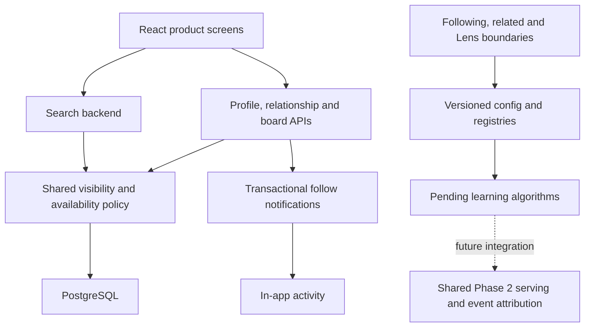

# Phase 4: first product extensions and discovery exercises

Status: **started; keyword search and the first social/board modules are implemented.**
This is the first independent Phase 4 milestone, not completion of the entire phase.
Following/related/Lens learning algorithms and the remaining product extensions are pending.
Phase 2/3A/3B acceptance remains pending; moving branches does not complete those phases.

## What works

| Module | Implementation | Purpose |
|---|---|---|
| Keyword search | `app/search/service.py`, `api.py`, `SearchBar.tsx` | PostgreSQL English full-text matching of title/description, recency/ID pagination, title suggestions and filters |
| Public profiles | `app/social/api.py`, `schemas.py`, `Social.tsx` | Display name/bio, profile editing, name lookup, followers/following and public board browsing without exposing account credentials |
| Social relationships | `app/social/models.py`, `api.py` | User/board follows, retries, blocking, muting and removal of cross-user relationships when blocked |
| Visibility policy | `app/social/policy.py`, reused by existing product reads | Prevent signed-in blocked users from seeing each other's profiles, board membership, pins and media; suppress muted creators in catalog/search |
| Board publication | `app/boards/api.py`, `BoardTools.tsx`, existing board routes | Explicit public/secret choice, read public boards, revoke board follows when made secret |
| Board sections | `BoardSection`, `Save.section_id`, board routes/UI | Organize saved pins, filter by section, move back to the board when a section is deleted |
| In-app activity | `Notification`, social routes, `Activity` in `Social.tsx` | Notify the followed user/board owner once per newly created relationship and acknowledge read state |
| Lens input preparation | `app/discovery/crop.py` | Validate upload/crop, apply EXIF orientation, crop in normalized coordinates, flatten transparency, remove metadata and hash transient RGB pixels |
| Learning boundaries | `app/ml/discovery.py`, `app/discovery/{config,service,api}.py` | Typed Following/related/crop-embedding/Lens/evaluation interfaces, versioned registries/config and five pending exercise groups |
| Prerequisite inventory | `scripts/phase4_preflight.py` | Inventory pending exercises and remaining modules; static reporting, not a completion or quality certificate |

All paths starting `app/` are under `backend/`. Frontend files are under `frontend/src/`.
Migration `d12ac1433a55` extends the existing schema; no new third-party dependency is needed.



## How to try it

```bash
docker compose up --build -d --wait
make check
make integration
make web-check
make browser-check
make phase4-preflight
```

Open http://localhost:8080. Search by keyword and collection. Create a board, save pins,
add a section and move a saved pin into it. A board starts secret; use **Make public** to
publish its membership. Open **My profile** to edit the name/bio. **People** looks up names
and opens profiles and public boards. Signed-in users can follow/mute/block another user,
follow their public board, and inspect **Activity**. Activity includes unblock/unmute controls.
The closeup's **View creator** opens a profile. The original upload/save/browse loop remains.

## API boundaries

| API | Behavior |
|---|---|
| `GET /api/search/pins` | `q`, owner ID, provenance, aware created-after/before dates, limit and cursor |
| `GET /api/search/suggest` | Prefix on the last ASCII token, matching titles, same eligibility/filters |
| `GET /api/profiles` | Name substring lookup with ID pagination |
| `GET /api/profiles/{id}` | Public fields and social counts; no email/hash/source key |
| `PATCH /api/profiles/me` | Replace current user's display name and bio |
| `GET /api/profiles/{id}/connections/{followers\|following}` | Paginated visible profile list |
| `GET /api/profiles/{id}/boards`, `/pins` | Public boards/ready creations; owners can also list their own secret boards |
| `PUT/DELETE /api/social/users/{id}/{follow\|block\|mute}` | Idempotent relationship mutation with authentication and Origin check |
| `PUT/DELETE /api/social/boards/{id}/follow` | Follow visible public boards/unfollow |
| `GET /api/social/preferences` | Current user's blocked/muted people (first 100 of each in this first milestone) |
| `GET /api/boards/{id}` | Authorized board details |
| `PUT /api/boards/{id}` | Owner replaces name and publication setting; making secret deletes existing board follows |
| `GET/POST /api/boards/{id}/sections` | Visible list / owner creates a named section |
| `DELETE /api/boards/{id}/sections/{section}` | Owner deletes section; saved pins remain |
| `PUT /api/boards/{id}/pins/{pin}/section` | Owner assigns a saved pin to a same-board section, or clears with null |
| `GET /api/boards/{id}/pins?section_id=...` | Authorized saved-pin page, optionally filtered by section |
| `GET /api/notifications` | Current recipient's recent-first activity with timestamp/ID pagination |
| `PUT /api/notifications/{id}/read` | Recipient-only, repeatable read acknowledgment |
| `GET /api/feed/following`, `/api/pins/{id}/related` | Authenticated boundaries; currently explicit Phase 4 pending 503 |
| `POST /api/lens` | Authenticated image and crop validation; valid inputs reach the explicit pending Lens service |

The UI exposes query/collection search filters; owner/date filters are currently API-only.
For local H&M imports, provenance is `hm`, not `hm_import`. Search returns a request ID
and backend version. The search backend implements a small protocol and is set on app state.
This first catalog search is deterministic recency ordering of keyword matches, not learned
relevance. GIN indexes the stored generated search document, including already-existing pins.
Pagination is bound to the normalized query and all filters; changing filters with an old
cursor returns 422. Newly added matches do not cause duplicates on subsequent keyset pages.
The last-token prefix suggestion is a bounded catalog lookup, not a query-log popularity model.

## Privacy, concurrency and data meaning

Existing owner-only boards become secret during migration. Publishing never happens just
because a new column was added. A secret board hides its name, membership and sections from
other users. **It does not make uploaded pins private:** pins already belong to the public
catalog. Deleting a section keeps its saves and clears their section; a composite foreign key
enforces same-board membership. That constraint is deferred until commit so the separate
section foreign key can apply `SET NULL` on deletion. Invalid final membership still fails.

Blocks apply in both directions for authenticated reads and remove user/board follows and
cross-user notifications. Anonymous public browsing has no signed-in identity against which
to enforce a block; this is relationship control, not confidential pin access. Mutes suppress
catalog/search discovery and activity, but do not deny direct profile/pin/board access.
Media now uses private/no-store caching so authenticated block decisions are checked again.
Later ML sources must reuse the same policy; they are not implemented by this module.

Follow/block operations lock both user rows in ID order; concurrent follows cannot add a
second relationship or duplicate its notification. Board follows also lock and re-read the
board before checking current privacy. Owner publication writes lock the board and revoke
follows transactionally when it becomes secret. An unfollow then later follow is a new
transition and may legitimately notify again. Notification delivery is transactional in-app
fan-out on write; external email, delivery queues and digest scheduling are not implemented.

These product records are **not Phase 2 engagements**. Search results currently have request
and backend attribution only; they are not persisted served-items, do not create impressions,
and cannot yet support request-linked ML view events. Shared Phase 2 serving/event work is
still required. Existing simulator capability declarations remain diagnostics-only and
`ready_for_traffic=false`; no run adapter/reset or simulator engine is added here.

## Learning modules and acceptance

The existing WORKING_AGREEMENT keeps core recommendation/embedding logic as exercises.
`Settings.discovery_config` resolves named Following, related, crop encoder and Lens
implementations from typed registries at startup. Unknown versions fail before serving;
register another protocol implementation and select its version for an experiment. Supply
`DISCOVERY_CONFIG` as JSON for environment-based selection. The Lens service receives its
selected crop encoder; selection itself performs no inference. Actual runtime/weight recipes,
attributed serving and model rollout remain core acceptance work. Simulator baseline/reset
must incorporate these configuration versions before advertising those future controls.

1. `phase4-following`: fan-out on read from followed creators and public boards, deduplicate,
   preserve sources, apply time/privacy policy, build scoring features and use shared serving.
   Alternative/revisit: precomputed fan-out on write and invalidation after privacy changes.
2. `phase4-related`: count shared public boards, then explicit same-version similarity
   fallback. Compare with similarity alone on fixed eligible candidates. Exclude secret board
   information and the context pin. Alternative/revisit: graph walks or learned similarity.
3. `phase4-lens-embedding`: pinned image-only CLIP crop inference. Declare compatibility with
   the catalog's image/title recipe; the two recipes can change retrieval quality. No implicit
   runtime/weight download. Alternative/revisit: proposed object crops and product-only index.
4. `phase4-lens-serving`: filter available/known, same-version catalog vectors, compare exact
   and ANN retrieval, integrate candidate privacy and shared served-item persistence. Bind
   response/cursor to crop and versions. Alternative/revisit: index types and recall/latency.
5. `phase4-lens-evaluation`: exact/ANN top-k overlap, eligible corpus, cold/partial crops and
   measured elapsed latency. Overlap is agreement with a reference, not real-user relevance.
   Require a reproducible real-catalog report, not only passing toy-vector targets.

```bash
make phase4-exercises
```

The six opt-in Lens checks are known-answer targets and currently fail at the named TODOs.
Normal checks skip them. Five TODO groups cover more work than those six targets: Following
and related integration/privacy/time acceptance, real inference, serving attribution and
ANN reporting require additional acceptance tests as the core is implemented. Ordinary
green checks establish product/scaffold behavior only. `--fail-on-pending` exits 2.

Explain-back outcomes are pending:

- Why does a secret board not make its uploaded pins private? How does making a board
  secret affect existing followers and cached responses?
- How do ordered locks prevent follow/block races? When should a repeat follow notify again?
- What does exact/ANN overlap establish, and what remains untested about image-title fusion
  and crop relevance? Which versions and timestamps must match before comparing results?

## Remaining Phase 4 scope

Interest onboarding and its ranking integration, URL import, comments/reactions/hide/report,
email digest, moderation queue, classifier/duplicate gate and richer profile/settings remain.
The first product modules can be tested now; recommendation-serving acceptance requires the
unfinished Phase 2 core and Phase 3A features/models. Phase 3B's CTR and simulator adapter/reset
remain independent pending tracks. No Phase 4 completion tag, trained crop model, Lens results,
Following feed, related grid or offline quality improvement is claimed.

Validation results are recorded in PROGRESS.md. Code is on `phase-4`; `phase-3b-scaffold`
preserves the prior tooling checkpoint. Git history does not restore database/object state;
run earlier versions with isolated stores as described in MILESTONES.md.
