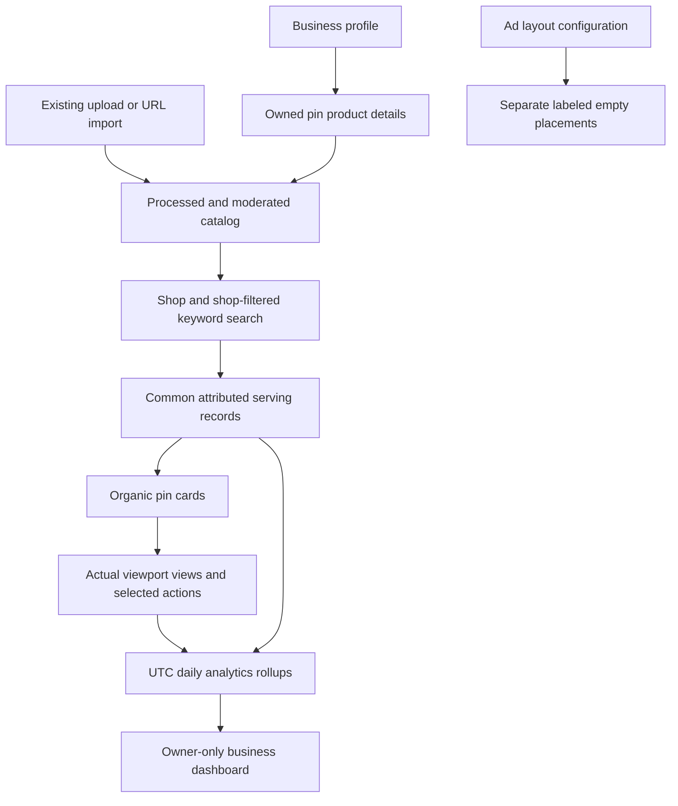

# Phase 5: thin monetization

Phase 5 adds business profiles, product metadata, shopping discovery, empty ad placements
and private creator analytics. It reuses the existing catalog, media processing, visibility
policy, attributed serving and event ledger. The full ads system, checkout, payments,
auctions, billing and conversion attribution remain separate projects.

## Modules and their goals

| Module | Implementation | Goal |
| --- | --- | --- |
| Business accounts | `monetization/api.py`, business fields on `User` | Explicitly enable a self-declared business profile and privately access creator tools |
| Product data | `monetization/{models,schemas,api}.py` | Attach an exact decimal price, currency, availability and shop link to an owned pin |
| Shopping | `monetization/shopping.py`, Shop API, shared `search.eligible` | Browse purchasable products or restrict keyword search/typeahead to products |
| Ad placeholders | `AdsConfig`, `/ads/layout`, `Monetization.tsx` | Practice labeled feed placement without advertising selection or financial effects |
| Daily analytics | `monetization/analytics.py`, `PinDailyRollup` | Keep returned pins, viewed pins and accepted actions separate in reproducible daily counts |
| Analytics refresh | `monetization/worker.py`, `scripts/rollup_analytics.py` | Repair recent late receipts automatically and rebuild older periods explicitly |
| Product experience | `Monetization.tsx`, App, Closeup, SearchBar, profiles | Business conversion/editing, product editing/details, Shop browsing and private reporting |



Ad placeholders do not enter the catalog, event ledger or rollups. Product details do not
change the home ranker. Shop uses recency ordering and a separate `shop` surface.

## Try the implementation

Start the app with `make up` (or the existing verified weights plus
`docker compose up --build -d --wait`). Open http://localhost:8080.

1. Sign in and open **Business**. Enter a business name and optional website, then enable
   the account. Existing authentication, boards, settings and moderator status are preserved.
2. Upload a pin, wait for it to become ready, open it from **Uploads**, and choose
   **Add product details**. Enter price, currency, availability and a direct shop link.
3. Open **Shop** to browse all purchasable products or filter by words/currency. Ordinary
   keyword search also has **Shop only**, which applies to its suggestions and results.
4. Open a product to see its price and availability or visit the merchant website.
   Editing/removing product details does not delete the underlying pin or its saves.
5. Return to **Business** and **Refresh analytics**. Choose a period or traffic source,
   inspect totals, per-pin counts and daily activity. A notice identifies days that have
   not yet been calculated. More than 30 owned pins are paginated.
6. **Discover** shows up to two clearly labeled ad placeholders after every eight organic
   cards by default. They are empty placements with no advertiser, tracking or payment.

The existing 32 demo pins have no owner/product records and are retained. Shop is empty
until a business account adds eligible products; there are no fabricated offers.
Business labels are self-declared, not merchant verification. Becoming a business never
grants moderator privileges. This thin version supports conversion to business and profile
updates; returning to a personal account is a future account-management feature.

## API

| Route | Behavior |
| --- | --- |
| `GET/PUT /api/business/profile` | Read or enable/update the signed-in account's business name and optional website |
| `PUT/DELETE /api/pins/{id}/product` | Business owner only; create/update/remove product data; retries cannot create a second product |
| `GET /api/shop/pins` | Public browsing, optional `q`, `currency`, `limit`, `cursor`; signed-in requests record served items |
| `GET /api/search/pins?shop_only=true` | Existing keyword search with product eligibility applied |
| `GET /api/search/suggest?shop_only=true` | Suggestions from the same eligible product catalog |
| `GET /api/ads/layout` | Versioned empty placement configuration |
| `GET /api/business/analytics` | Owner-only report with `start`, `end`, `traffic`, `limit`, `cursor` |
| `POST /api/business/analytics/refresh` | Rebuild only the current business account's bounded date range |

Business/product/refresh mutations retain the existing origin check. Public profiles expose
only the business label/name/website; analytics never accept an owner ID from the caller.
Product metadata appears in PinOut across catalog, feeds, search, boards and closeups.

Product prices use PostgreSQL `numeric(12,2)` and serialize as decimal strings. They must
be positive with at most two fractional digits. This demo supports USD, CAD, EUR, GBP,
AUD, NZD, SEK and DKK, with no exchange-rate or currency conversion logic. Availability is
`in_stock`, `out_of_stock`, `preorder` or `discontinued`. Shop includes only in-stock and
preorder products with a business owner, ready media and eligible creation/availability
times. Blocks, mutes, hides and moderation exclusions use shared catalog policy. Links
must be HTTP(S) and have no embedded credentials; this module never fetches shop websites.

Shop cursors bind normalized search words, currency, viewer identity and the Shop surface.
Changing those inputs requires starting a new page sequence. Keyword search cursors also
include the new shop filter. Current catalog/stock changes can move items between pages;
these are live lists, not frozen sessions.

## Daily rollups and their meaning

The raw tables remain the source of truth. `rebuild` executes these steps:

1. Validate an ordered UTC-day range and a timezone-aware receipt cutoff. Reject future
   days and bound a CLI rebuild to 366 days; API ranges are limited to 90 days.
2. Take a transaction advisory lock to serialize overlapping rebuilds.
3. Select pins belonging to business accounts, optionally restricted to one owner.
4. Count `ServedItem` joined to `FeedRequest` by served UTC day for **pins returned**.
5. Count canonical `Impression` rows by event UTC day for **views**. Receipt aliases and
   repeated IDs never create additional canonical views.
6. Count accepted `Engagement` rows separately for **closeups**, **save actions** and
   **outbound clicks**. Attributed, pending and direct/unattributed actions are included.
7. In every count, require both occurrence and receipt no later than the cutoff. Group
   `sim_run_id IS NULL` as `app`, and non-null run IDs as `simulator`; never mix the two.
8. Generate a row for every selected pin/day/source, including zero counts, and upsert
   replacement values in batches. Record cutoff, computation time and policy version.
9. Commit the complete rebuild together. Repeating it replaces counts rather than adding
   them; a failed transaction leaves the previous report intact.

The primary key is `(pin_id, day, traffic)`. `analytics:utc-day-canonical-events:v1` records
the policy. Views use the existing 50%-visible-for-one-second browser rule. One pin viewed
in separate requests can have several views. Save actions are telemetry actions, not the
number of current board memberships, unique savers or purchases. Own previews/actions are
included. Imported purchases, reports, likes and comments are not folded into these counts.
No CTR, revenue, conversions, causal lift or real-user preference metric is inferred.

GET reads materialized rollups. It includes per-pin pagination, daily sums, totals, the
latest computation time and missing days. The coverage check requires a rollup for every
currently owned pin on each selected day; missing rows are distinguishable from observed
zero counts. Changing product details or hiding a pin does not erase historical events.
Deleting raw records/accounts can change the next rebuilt report; this is not an immutable
financial ledger.

`analytics-worker` rebuilds the latest seven UTC days at startup and each hour, retrying
failures every minute. This repairs late events in that interval. For an older event or a
longer dashboard period, explicitly refresh or run:

```bash
make analytics-rollup
uv run --locked python -m scripts.rollup_analytics --start 2026-10-01 --end 2026-10-07
```

The worker runs direct SQL, separately from image jobs; it cannot consume the RQ media
queue. This local serialized recomputation is a correctness baseline. Incremental updates,
partitioned aggregations, scheduling through a durable job queue and retention are revisit
experiments. A transaction that commits after the cutoff query may appear in the next
rebuild; counts are eventually refreshed, not a synchronous billing guarantee.

## Configuration and historical checkpoints

```bash
ADS_CONFIG='{"enabled":false}'                     # no placements
ADS_CONFIG='{"after_every":12,"max_slots":1}'      # change layout without changing ranking
```

Set environment values before restarting/rebuilding the relevant services. Placeholder
cards are siblings of organic `.pin-card` elements, never wrapped by `ViewedPin`. Organic
served positions stay unchanged; there are no ad IDs, ad impressions, auctions or charges.

Migration `e9b3c71d5f02` extends Phase 4's `4f1a7b239abc`. Existing users default to personal;
existing pins stay ordinary pins. The `phase-4` tag remains the earlier product checkpoint.
Phase 5 uses branch/tag `phase-5`; see MILESTONES.md for isolated historical worktrees and
separate application state. Code tags do not snapshot databases, media or model weights.

## Validation and explain-back

Unit checks cover price/link validation, bounded windows/configuration and cursor scope.
Real-service acceptance covers role/ownership/origin checks, product serialization,
stock/time/visibility filters, retry-safe view/action counts, source separation, late receipt
repair, zero activity and additive migration downgrade/re-upgrade. Browser checks exercise
conversion, editing, Shop, actual viewport telemetry, merchant clicks, analytics, stock
changes and empty ad placement on desktop/mobile. Final evidence is in
`docs/reports/phase5-checks.json`.

Explain back: Why is a returned pin different from a view? How does recomputation include a
late receipt without double counting earlier events? Why should simulator activity have
its own reporting source? Discussion remains open; no learning answers are assumed.
